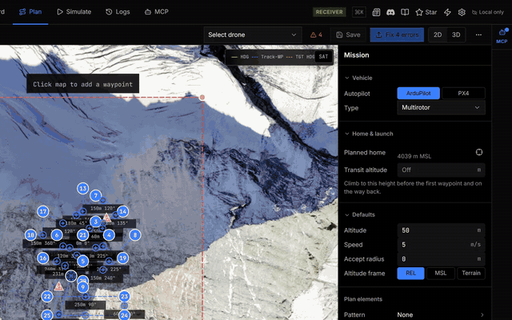
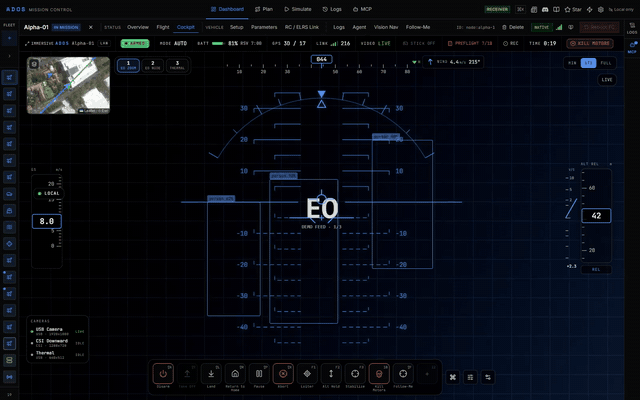
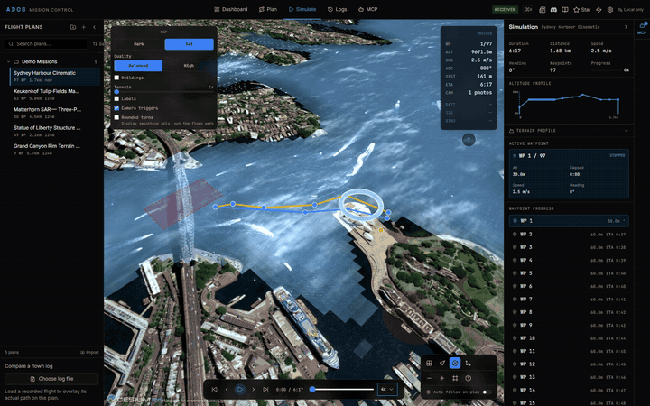
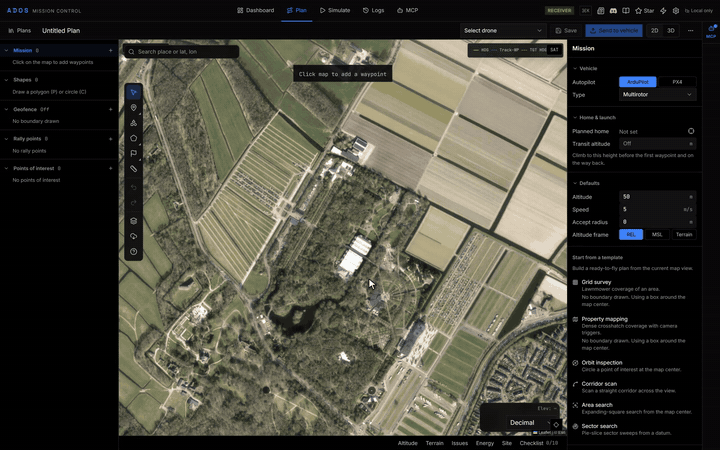
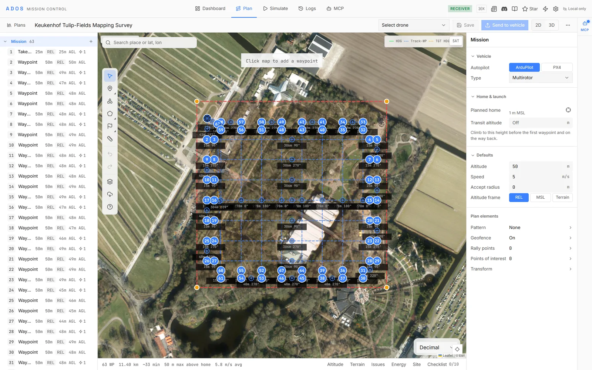
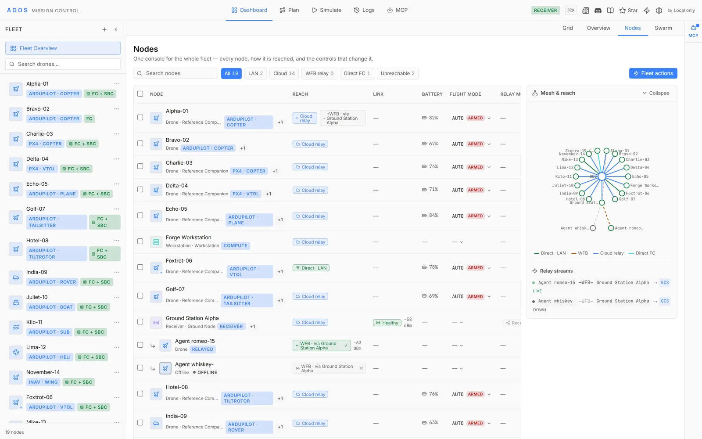
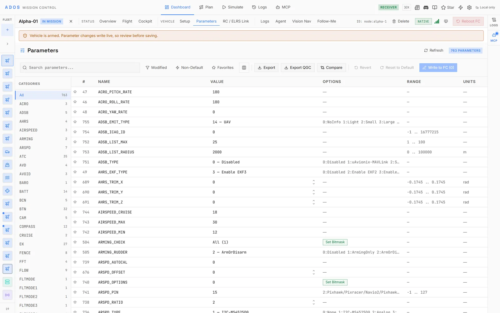
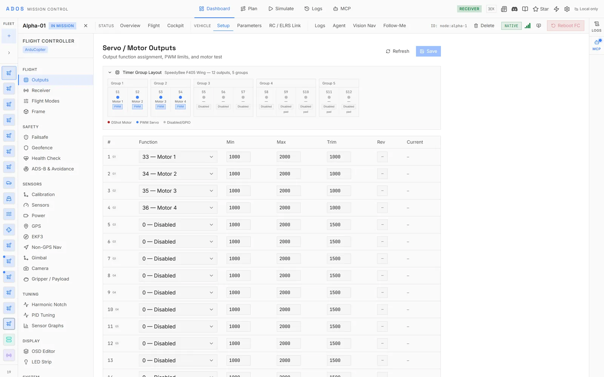
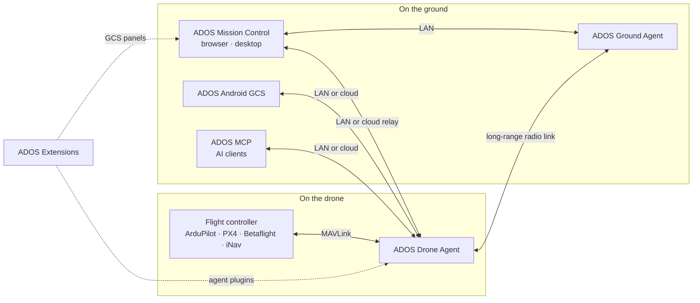

<p align="center">
  <a href="https://altnautica.com">
    <picture>
      <source media="(prefers-color-scheme: dark)" srcset=".github/assets/brand/altnautica-wordmark-dark.svg">
      
    </picture>
  </a>
</p>
<h1 align="center">ADOS Mission Control</h1>
<p align="center"><em>Open-source ground control station for software-defined drones. ArduPilot, PX4, Betaflight and iNav, in the browser.</em></p>
<p align="center">    <a href="https://discord.gg/uxbvuD4d5q"></a></p>
<p align="center">
  <strong><a href="https://github.com/altnautica/ADOSMissionControl">Mission Control</a></strong> |
  <strong><a href="https://github.com/altnautica/ADOSDroneAgent">Drone Agent</a></strong> |
  <strong><a href="https://github.com/altnautica/ADOSAndroidGCS">Android GCS</a></strong> |
  <strong><a href="https://github.com/altnautica/ADOSExtensions">Extensions</a></strong> |
  <strong><a href="https://github.com/altnautica/ADOS-MCP">MCP</a></strong> |
  <strong><a href="https://github.com/altnautica/ADOSDroneAgent/tree/main/crates#published-crates">Rust crates</a></strong> |
  <strong><a href="https://docs.altnautica.com">Docs</a></strong> |
  <strong><a href="https://altnautica.com">Website</a></strong> |
  <strong><a href="https://discord.gg/uxbvuD4d5q">Discord</a></strong>
</p>

<p align="center"><a href="https://command.altnautica.com">Live App</a> · <a href="https://command.altnautica.com/community/changelog">Changelog</a> · <a href="https://command.altnautica.com/community/contact">Contact</a> · <a href="https://github.com/altnautica/ADOSMissionControl/issues">Issues</a></p>

https://github.com/user-attachments/assets/09f265f4-b692-468a-a170-2be2d8525ae7

ADOS Mission Control is the ground control station of ADOS, an open-source platform for software-defined drones. Open it in a browser, connect a flight controller, and you can set it up panel by panel, plan a mission with pattern generators, fly it with a gamepad at 50 Hz and tune PIDs with AI help. No install. No locked hardware.

On its own it talks to any MAVLink or MSP flight controller over USB or WebSocket. Pair it with an [ADOS Drone Agent](https://github.com/altnautica/ADOSDroneAgent) on the drone's companion computer and it becomes the one place you run the whole aircraft: the flight controller, the long-range radio and HD video link, onboard vision, swarm settings, World Engine (in beta) and every extension you install.

## Quick Start

Try it right now at [command.altnautica.com](https://command.altnautica.com). No install needed. Demo mode loads simulated drones with live telemetry, mission planning, and full FC configuration.

Or run locally:

```bash
git clone https://github.com/altnautica/ADOSMissionControl.git
cd ADOSMissionControl
npm install
npm run demo
```

Open [http://localhost:4000](http://localhost:4000). Simulated drones, no hardware required.

## Features

<table>
  <tr>
    <td width="50%">
      <br>
      <sub>Plan missions in 3D over real terrain. <a href="https://docs.altnautica.com/mission-control/mission-planning">Docs</a></sub>
    </td>
    <td width="50%">
      <br>
      <sub>Fly from the cockpit with live video and a gamepad. <a href="https://docs.altnautica.com/mission-control/cockpit">Docs</a></sub>
    </td>
  </tr>
  <tr>
    <td width="50%">
      <br>
      <sub>Rehearse a mission on a Cesium globe before you fly it. <a href="https://docs.altnautica.com/mission-control/simulation">Docs</a></sub>
    </td>
    <td width="50%">
      <br>
      <sub>Generate survey, orbit, corridor and search patterns. <a href="https://docs.altnautica.com/mission-control/pattern-generators">Docs</a></sub>
    </td>
  </tr>
  <tr>
    <td width="50%">
      <picture>
        <source media="(prefers-color-scheme: dark)" srcset=".github/assets/screens/dashboard-dark.webp">
        
      </picture><br>
      <sub>See every drone and node on one dashboard. <a href="https://docs.altnautica.com/mission-control/dashboard">Docs</a></sub>
    </td>
    <td width="50%">
      <picture>
        <source media="(prefers-color-scheme: dark)" srcset=".github/assets/screens/plan-dark.webp">
        
      </picture><br>
      <sub>Edit waypoints with a terrain profile and validation. <a href="https://docs.altnautica.com/mission-control/mission-planning">Docs</a></sub>
    </td>
  </tr>
  <tr>
    <td width="50%">
      <picture>
        <source media="(prefers-color-scheme: dark)" srcset=".github/assets/screens/fleet-nodes-dark.webp">
        
      </picture><br>
      <sub>Manage paired drones and ground nodes. <a href="https://docs.altnautica.com/mission-control/nodes-fleet-view">Docs</a></sub>
    </td>
    <td width="50%">
      <picture>
        <source media="(prefers-color-scheme: dark)" srcset=".github/assets/screens/parameters-dark.webp">
        
      </picture><br>
      <sub>Search, edit and write every FC parameter. <a href="https://docs.altnautica.com/mission-control/parameters">Docs</a></sub>
    </td>
  </tr>
  <tr>
    <td width="50%">
      <picture>
        <source media="(prefers-color-scheme: dark)" srcset=".github/assets/screens/setup-dark.webp">
        
      </picture><br>
      <sub>Set up the flight controller panel by panel. <a href="https://docs.altnautica.com/mission-control/fc-configuration">Docs</a></sub>
    </td>
    <td width="50%">
      <picture>
        <source media="(prefers-color-scheme: dark)" srcset=".github/assets/screens/mcp-wizard-dark.webp">
        
      </picture><br>
      <sub>Connect an AI client through the MCP wizard. <a href="https://docs.altnautica.com/mission-control/mcp">Docs</a></sub>
    </td>
  </tr>
</table>

## What it lets you do

- **Connect to any drone, no driver install.** Plug in over USB (WebSerial), point at a MAVLink WebSocket, or pair with an ADOS agent over your LAN.
- **Set up the whole flight controller.** More than 80 panels cover calibration, PID tuning, receivers, outputs, failsafe, power, ports, OSD, firmware flashing, and the iNav-specific surfaces.
- **Plan a mission by drawing it.** Drop waypoints on the map, generate survey, orbit, corridor, SAR, and structure-scan patterns, follow terrain, set geofences and rally points, then validate before upload.
- **Fly with a real controller.** Gamepad, HOTAS, RC transmitter, or keyboard at 50 Hz, with arm/disarm, mode switching, guided flight, and a kill switch.
- **Rehearse in 3D.** Replay a mission over real terrain on a Cesium globe before you fly it.
- **Tune PIDs with help.** FFT-driven noise and motor-health analysis suggests filter settings and PID values.
- **Manage a fleet from anywhere.** Cloud mode adds multi-drone dashboards, mission sync, and real-time telemetry over MQTT.
- **Sign your commands.** HMAC-SHA256 on every outbound MAVLink v2 frame, with the key held only in your browser.
- **Self-host all of it.** Field operations work fully offline, and the cloud relay can run entirely on your own servers.

## One system with the Drone Agent

Open a drone that runs the ADOS Drone Agent and Mission Control shows the flight controller and the companion computer as one node:

- **Vehicle.** Flight controller setup and the full parameter editor, carried over MAVLink by the agent, including drones reached through a ground station's radio relay.
- **Agent.** Health with per-service restart and the connected peripherals, battery and profile, the radio link and its setup, networking (Wi-Fi, cellular, MAC pinning, discovery, MAVLink routing and signing), cameras and perception, swarm, cloud relay, security and advanced settings.
- **Extensions.** Install and update plugins from the same panel. An extension can add its own pages there, the way World Engine adds its world model and perception offload pages.
- **Logs.** Flight logs and the agent's on-board recorder.

## Smart and autonomous features

- **Cockpit skills.** The Skill Bar puts flight skills one tap away: take off, land, return home, pause, resume, fly here, change mode and abort. Extensions add their own, such as Follow-Me, which follows a subject you click in the live video.
- **Swarm view.** A fleet board with a map, a video rail and bulk actions, including formation commands. Per-drone swarm settings drive the agent's onboard swarm layer, and each drone reports which layer is in control right now.
- **World Engine (beta).** Start a capture, watch the 3D world model build, then open it as a Gaussian splat, a point cloud or a Rerun recording, next to the compute node's job queue and the perception offload settings.
- **Vision and perception.** Camera and perception pages for the agent's onboard vision, and Vision Navigation for GPS-denied flight on optical flow, with its estimator state and pre-arm status.
- **AI that helps, and AI that operates.** AI PID tuning suggests filter and PID values from your flight data. The MCP wizard connects an AI client to your drones through [ADOS MCP](https://github.com/altnautica/ADOS-MCP), under scopes you grant and behind a safety gate.

These features are under active development and grow with every release; build on them through extensions and the SDK.

## What you can build on it

ADOS is a base, not a finished product for one job. These are directions it is built toward, with the pieces that exist for them today:

- **Smart agriculture.** Survey and terrain-following missions planned here, RTK corrections the agent injects into the flight controller, and payload devices such as sprayers or droppers that extensions can register.
- **Indoor operations.** GPS-denied flight on optical flow with Vision Navigation, and visual-inertial or LiDAR SLAM poses with indoor world models from World Engine (beta).
- **Logistics in GPS-denied warehouses.** The same positioning sources, a warehouse reconstruction preset in World Engine, and perception offload so a drone without an NPU can run detection on a nearby compute node.

The parts are open, so you can take them where you need them.

## Build on it

ADOS is meant to be extended. An extension has a Mission Control half (React panels in a sandboxed frame) and a Drone Agent half (Python or Rust), packed into one signed archive. Start from [ADOS Extensions](https://github.com/altnautica/ADOSExtensions) and the [developer docs](https://docs.altnautica.com/developers/overview). Rust plugins build on the [`ados-sdk`](https://docs.rs/ados-sdk) crate. Pull requests to Mission Control itself are welcome; see [Contributing](#contributing).

## Where it fits

Mission Control is the browser and desktop ground station of the ADOS ecosystem. It reaches the [Drone Agent](https://github.com/altnautica/ADOSDroneAgent) over your LAN or the cloud relay, and a ground node running the Ground Agent profile when the drone is out on the long-range radio link. [Android GCS](https://github.com/altnautica/ADOSAndroidGCS) flies the same drones from a phone or tablet, [Extensions](https://github.com/altnautica/ADOSExtensions) add panels here and code on the drone, [ADOS MCP](https://github.com/altnautica/ADOS-MCP) gives AI clients scoped access to the same agents, and the agent's reusable code ships as published Rust crates.

---

## How ADOS fits together



ADOS Ground Agent is the Drone Agent running its ground-station profile.

<!-- ados-family:repos -->
| Repo | Runs on | What it does | Link |
|---|---|---|---|
| ADOS Mission Control | Browser, desktop (Electron) | Ground control station: FC setup, mission planning, flight, 3D simulation, fleet | [ADOSMissionControl](https://github.com/altnautica/ADOSMissionControl) |
| ADOS Drone Agent | Companion computer on the drone, or a ground node | Onboard agent: MAVLink routing, HD video, long-range radio link, plugins, remote control | [ADOSDroneAgent](https://github.com/altnautica/ADOSDroneAgent) |
| ADOS Android GCS | Android phones and tablets | Native ground control app for agents on the LAN, direct flight controllers and the cloud | [ADOSAndroidGCS](https://github.com/altnautica/ADOSAndroidGCS) |
| ADOS Extensions | Drone Agent and Mission Control | First-party signed plugins, each with an agent half and a GCS half | [ADOSExtensions](https://github.com/altnautica/ADOSExtensions) |
| ADOS MCP | Your machine | Model Context Protocol server that lets AI clients operate ADOS drones under scopes and a safety gate | [ADOS-MCP](https://github.com/altnautica/ADOS-MCP) |
| Documentation | docs.altnautica.com | Public docs for every ADOS product | [Documentation](https://github.com/altnautica/Documentation) |
<!-- /ados-family:repos -->

### ADOS Rust crates

Reusable libraries from the ADOS Drone Agent, published on crates.io. Versioning and licences: [crates index](https://github.com/altnautica/ADOSDroneAgent/tree/main/crates#published-crates).

<!-- ados-family:crates -->
**Platform (versioned with the ADOS Drone Agent)**

| Crate | What it does | Docs |
|---|---|---|
| [`ados-protocol`](https://crates.io/crates/ados-protocol) | Wire contracts of the ADOS Drone Agent: IPC framing, plugin RPC envelope, capability tokens and the vision frame bus. | [docs.rs](https://docs.rs/ados-protocol) |
| [`ados-sdk`](https://crates.io/crates/ados-sdk) | Write Rust plugins for the ADOS Drone Agent: IPC client, plugin context, driver traits and lifecycle runner. | [docs.rs](https://docs.rs/ados-sdk) |
| [`ados-vision`](https://crates.io/crates/ados-vision) | Single-object visual tracker: Kalman motion model, appearance re-identification and YOLOv8 head decoding. | [docs.rs](https://docs.rs/ados-vision) |
| [`ados-gpio`](https://crates.io/crates/ados-gpio) | Drive status buzzers and LEDs on Linux GPIO lines, with bounded software-PWM beep patterns. | [docs.rs](https://docs.rs/ados-gpio) |
| [`ados-hal-probe`](https://crates.io/crates/ados-hal-probe) | Find out what a board's hardware can really do by probing it, plus bundled board profiles. | [docs.rs](https://docs.rs/ados-hal-probe) |

**Standalone**

| Crate | What it does | Docs |
|---|---|---|
| [`ados-sensorhub`](https://crates.io/crates/ados-sensorhub) | Sensor hub wire protocol: COBS framing, CRC-16 and fixed-layout IMU, baro, mag and GNSS packets. no_std. | [docs.rs](https://docs.rs/ados-sensorhub) |
| [`ados-offload`](https://crates.io/crates/ados-offload) | Choose where perception runs (onboard, offloaded or hybrid) and hold the vehicle when results go stale. | [docs.rs](https://docs.rs/ados-offload) |
| [`ados-macpin`](https://crates.io/crates/ados-macpin) | Stable MAC addresses for Linux network adapters that randomize theirs every boot. | [docs.rs](https://docs.rs/ados-macpin) |
| [`ados-lora`](https://crates.io/crates/ados-lora) | LoRa transmit governor with cited regional band plans, duty cycle, dwell time and airtime accounting. | [docs.rs](https://docs.rs/ados-lora) |
| [`ados-crsf-codec`](https://crates.io/crates/ados-crsf-codec) | no_std CRSF / ExpressLRS codec for RC channels, telemetry and parameter frames. | [docs.rs](https://docs.rs/ados-crsf-codec) |
| [`ados-positioning`](https://crates.io/crates/ados-positioning) | Split mixed UBX, NMEA and RTCM3 GNSS streams, configure u-blox receivers and run an RTK base survey-in. | [docs.rs](https://docs.rs/ados-positioning) |
| [`ados-rtcm`](https://crates.io/crates/ados-rtcm) | RTCM3 framing, CRC-24Q and MAVLink GPS_RTCM_DATA fragmentation for RTK corrections. | [docs.rs](https://docs.rs/ados-rtcm) |
| [`ados-clock`](https://crates.io/crates/ados-clock) | Map remote clocks onto the host clock: least-squares and envelope fits, TIMESYNC and a chrony sink. | [docs.rs](https://docs.rs/ados-clock) |
| [`ados-swarm`](https://crates.io/crates/ados-swarm) | Swarm control laws: separation, flocking, formations, CBBA task allocation and a point-mass simulator. | [docs.rs](https://docs.rs/ados-swarm) |
| [`ados-mavlink-tunnel`](https://crates.io/crates/ados-mavlink-tunnel) | Send large messages over MAVLink TUNNEL frames with chunking and bounded reassembly. | [docs.rs](https://docs.rs/ados-mavlink-tunnel) |
| [`ados-display-driver`](https://crates.io/crates/ados-display-driver) | Small-display output on Linux: SSD1306/SH1106 OLED over I2C, pixel packers and a framebuffer writer. | [docs.rs](https://docs.rs/ados-display-driver) |
| [`ados-hmi`](https://crates.io/crates/ados-hmi) | Front-panel input: touchscreen calibration and gestures, button presses and rotary encoders. | [docs.rs](https://docs.rs/ados-hmi) |
<!-- /ados-family:crates -->

---

## What ADOS Mission Control Is

- **Platform:** Browser-based. Runs on any OS with a modern browser. Optional Electron desktop build for WebSerial and WebUSB access.
- **Firmware:** ArduPilot, PX4, Betaflight, and iNav as first-class targets.
- **Protocol:** MAVLink v2 and MSP v1/v2 in the same app, behind a unified `DroneProtocol` adapter interface.
- **Flight control:** Gamepad, HOTAS, RC transmitter, or keyboard input at 50 Hz.
- **AI tuning:** PID and filter analysis with FFT-driven noise and motor-health diagnosis.
- **3D simulation:** CesiumJS globe with real terrain and flight path replay.
- **Fleet mode:** MQTT and Convex relay for multi-drone dashboards. Self-hostable end to end.
- **License:** GPL-3.0-only.

The browser side is TypeScript. The onboard agent it pairs with, [ADOS Drone Agent](https://github.com/altnautica/ADOSDroneAgent), is Rust-first, which is what carries the long-range link, HD video, and headless operation on small boards.

---

## What It Does

### Configure your flight controller

More than 80 panels covering calibration, PID tuning, receiver, outputs, failsafe, power, ports, OSD, firmware flashing, plus iNav-specific panels for safehomes, geozones, navigation config, profiles, output mapping, servos, temp sensors, MC braking, rate dynamics, and mission summary. Works with ArduPilot, PX4, Betaflight, and iNav. **AI PID tuning** analyzes FFT noise and motor health, then suggests filter settings and PID values. Board auto-detection for firmware flashing. WebUSB firmware flashing with no external tools.

### Plan missions

Drag waypoints on an interactive map. Pattern generators for survey (boustrophedon), orbit, corridor, SAR (expanding square, sector, parallel track), structure scan, plus automated landing approaches. Terrain following from the open Terrain Tiles dataset. Geofence editor, rally points, batch waypoint editing, and mission validation before upload. Import and export KML, KMZ, CSV, `.waypoints`, `.plan`.

### Fly and simulate

Gamepad, HOTAS, RC transmitter, or keyboard input at 50 Hz. Arm/disarm, mode switching, guided flight, mission execution, kill switch. 3D Cesium globe simulation with real terrain, flight path replay, and camera presets.

### Monitor telemetry

Real-time attitude, GPS, battery, EKF status, vibration, RSSI, and sensor health. Pre-arm check visualization. Alert feed from the flight controller. Ring-buffered stores keep memory bounded across long sessions.

### Sign MAVLink commands

HMAC-SHA256 on every outbound MAVLink v2 frame. The 32-byte key lives only in your browser as a non-extractable Web Crypto key, and is enrolled with the flight controller once via `SETUP_SIGNING`. Flip require mode from the Configure tab Security panel to make the flight controller reject any unsigned command. ArduPilot 4.0 and newer supported today. See [docs](https://docs.altnautica.com/mission-control/mavlink-signing).

### Connect locally or over the cloud

ADOS is local-first. In field mode the GCS talks directly to hardware over WebSerial or WebSocket, or to an ADOS agent over the LAN by hostname or IP, with no cloud account. Cloud mode adds fleet management, mission sync, and MQTT telemetry relay for reaching drones across networks. When paired with ADOS Drone Agent, the GCS receives live telemetry at 2 Hz and faster and can send commands through the relay.

### Manage a ground station

When the paired agent runs in the ground-station profile, the node panel shows role-gated surfaces instead of the flight tabs: Network (uplink priority across WiFi, ethernet, and cellular, plus access-point management), Distributed RX (single-node link stats, relay list, combined stream stats), Mesh (batman-adv health, neighbors, gateways, and the pairing accept window), Display and Physical UI (OLED screens and button mappings), and Peripherals (connected USB and GPIO hardware). A role badge in the top bar shows at a glance whether a node is running as `direct`, `relay`, or `receiver`, and mesh events surface as non-blocking toasts.

---

## Firmware Support

| Firmware | Protocol | Status |
|----------|----------|--------|
| ArduPilot (Copter / Plane / Rover / Sub) | MAVLink v2 | Full |
| PX4 | MAVLink v2 | Full |
| Betaflight | MSP v1/v2 | Full |
| iNav | MSP v1/v2 | Full |

---

## By the Numbers

98 top-level Zustand stores. 87 flight-controller panels. Full demo mode with zero setup.

---

## Platform Support

| Platform | Requirements | Notes |
|----------|-------------|-------|
| Web (recommended) | Chrome 89+ or Edge 89+ | WebSerial and WebUSB for FC connection and firmware flashing |
| Web (limited) | Firefox, Safari | No WebSerial or WebUSB. WebSocket connections work. |
| Desktop (macOS) | Intel or Apple Silicon | Electron app, not code-signed |
| Desktop (Windows) | x64 | Electron app, `.exe` installer |
| Desktop (Linux) | x64 or arm64 | `.AppImage` |

3D features (simulation, terrain rendering) benefit from a dedicated GPU. Works without one, but frame rates will be lower.

---

## External Services

All optional. The GCS works fully offline for local FC configuration and field operations.

| Service | Purpose | Required? |
|---------|---------|-----------|
| [Convex](https://convex.dev) | Cloud fleet management, auth, community features | No (field mode works without) |
| [Terrain Tiles](https://registry.opendata.aws/terrain-tiles/) (AWS Open Data) | Ground heights for terrain checks, follow-terrain patterns and the terrain profile | No (terrain checks report "unchecked" without network) |
| [Cesium Ion](https://cesium.com/ion) | 3D terrain tiles and satellite imagery | No (uses ArcGIS terrain by default) |
| [Groq](https://console.groq.com) | AI PID tuning analysis | No (AI features disabled without key) |
| [GitHub API](https://github.com) | PX4 firmware release fetching | No (raises rate limit from 60 to 5000/hr) |

---

## Tech Stack

| Layer | Technology |
|-------|-----------|
| Framework | Next.js 16 (App Router, Turbopack) |
| UI | React 19, Tailwind v4 |
| State | Zustand 5 (ring-buffered telemetry) |
| Maps | Leaflet + react-leaflet |
| 3D simulation | CesiumJS |
| Protocol | Custom MAVLink v2 and MSP v1/v2 binary parsers |
| Transport | WebSocket, WebSerial, WebUSB |
| Backend | Convex (optional, cloud fleet and community features) |
| Desktop | Electron 44 |
| Language | TypeScript (strict) |

---

## Deployer (`ados-deploy`)

The stack ships with a full-screen terminal deployer that self-hosts the whole
cloud stack (Convex + Mission Control + MQTT + video relay) in one guided flow,
and also runs the web GCS, builds the desktop app, and manages a running stack.

```bash
# One-line convenience (clones the repo if needed, then launches the TUI):
curl -sSL https://raw.githubusercontent.com/altnautica/ADOSMissionControl/main/tools/deploy/deploy.sh | sh

# Local-first, from a checkout:
npm run deploy                    # interactive menu
npm run deploy -- deploy          # deploy the self-hosted stack (wizard)
npm run deploy -- deploy --plan   # preview the exact commands + files, run nothing
npm run deploy -- status          # a running stack's containers + reach links
```

The interactive menu covers: deploy the stack, manage a running stack (status /
logs / restart / upgrade / teardown), run the web GCS (dev), run demo mode,
build / run the desktop app, a system check, and the drone-agent install
one-liner. The primitive npm scripts (`dev`, `demo`, `build`, `desktop:*`,
`convex:*`) are what the deployer shells out to.

Prerequisites: Docker (with the daemon running) + Node 20+. See
[SELFHOSTING.md](SELFHOSTING.md) for the full self-host walkthrough.

---

## Connecting to Hardware

**WebSocket:** Connect to any MAVLink-over-WebSocket endpoint. Launch ArduPilot SITL with the bridge tool from [`tools/sitl/`](tools/sitl/) (`cd tools/sitl && npm run setup && npm start`).

**WebSerial (USB):** Plug in your FC, open Mission Control in Chrome 89+, click connect, pick the port. No drivers needed.

**ADOS agent (LAN):** Add a node by hostname or IP. Mission Control pairs with the agent directly over the local network. No cloud account required.

---

## Desktop App

```bash
npm run desktop:build:mac   # macOS .dmg
npm run desktop:build:win   # Windows .exe installer
npm run desktop:build:linux # Linux .AppImage
```

macOS: the app is not code-signed yet, so right-click it, choose Open, then Open again.

---

## Self-Hosted Web Server

A multi-stage `Dockerfile` ships at the repo root for running Mission Control as a long-lived web server (instead of the desktop app or local dev). Node 22 alpine base, Next.js standalone output, runs as an unprivileged user.

```bash
docker build \
  --build-arg NEXT_PUBLIC_CONVEX_URL=https://your-convex.example \
  -t ados-mission-control .

docker run -d \
  -p 4000:4000 \
  -e NEXT_PUBLIC_CONVEX_URL=https://your-convex.example \
  --restart unless-stopped \
  --name mission-control \
  ados-mission-control
```

Open `http://localhost:4000`.

**About `NEXT_PUBLIC_*` variables:** these get baked into the client JS bundle at build time. Pass them as `--build-arg` to `docker build` AND as `-e` to `docker run` (the runtime version is used by server components and route handlers). The Dockerfile declares each `NEXT_PUBLIC_*` as `ARG` plus `ENV` so build args propagate.

**Container orchestrators and PaaS:** the image works with anything that can build a Dockerfile. Point your tool at this repo, set the build pack to Dockerfile, expose port 4000, and configure the env vars above. No special framework integration is needed.

**Fronting with HTTPS:** the container serves plain HTTP on port 4000. Terminate TLS at any reverse proxy (Caddy, nginx, Traefik) or tunnel (Cloudflare Tunnel, Tailscale Funnel, ngrok). When fronting with a tunnel, route to `127.0.0.1:4000` rather than `localhost:4000`, since the standalone server binds IPv4 only.

For self-hosting the supporting cloud relay (Convex, MQTT, and video relay), see [SELFHOSTING.md](SELFHOSTING.md).

---

## Backend and Cloud Features

Field mode works with no backend. Cloud features need a Convex deployment:

```bash
npx convex init
npx @convex-dev/auth
npx convex dev
```

Set `NEXT_PUBLIC_CONVEX_URL` in `.env.local`. The first user to sign up becomes admin.

For self-hosted MQTT and video relay, run `npm run deploy -- deploy` for a guided wizard (port selection, conflict detection, config file generation, optional service start), or follow the manual steps in [SELFHOSTING.md](SELFHOSTING.md). Broker assets: [`tools/mqtt-bridge/`](tools/mqtt-bridge/); relay source: [`tools/video-relay/`](tools/video-relay/).

### Environment variables (`.env.local`)

All variables are optional. Set them by editing `.env.local` directly (or re-run the deployer). The file is gitignored and never committed.

| Variable | Description |
|----------|-------------|
| `NEXT_PUBLIC_DEMO_MODE` | Enable demo mode with simulated drones |
| `NEXT_PUBLIC_CONVEX_URL` | Convex backend URL for cloud fleet features |
| `GITHUB_TOKEN` | Raises the PX4 releases API limit from 60 to 5000 req/hr. Server-side only: export it in the server shell rather than writing it into `.env` |
| `GROQ_API_KEY` | AI PID tuning suggestions. Free at [console.groq.com](https://console.groq.com) |
| `CESIUM_BASE_URL` | Self-hosted Cesium JS URL (falls back to CDN if unset) |

### Tools

| Tool | Path | Description |
|------|------|-------------|
| SITL launcher | `tools/sitl/` | ArduPilot SITL plus TCP-to-WebSocket bridge |
| MQTT broker | `tools/mqtt-bridge/` | Mosquitto broker config, ACL and credential-sync scripts (Docker Compose) |
| Video relay | `tools/video-relay/` | RTSP-to-WebSocket fMP4 relay via ffmpeg (Docker Compose) |

---

## Community

- **[Discord](https://discord.gg/uxbvuD4d5q)** - Join the community, ask questions, share builds
- **[LinkedIn](https://www.linkedin.com/company/altnautica/)** - Follow company updates
- **[Email](mailto:team@altnautica.com)** - team@altnautica.com
- **[Changelog](https://command.altnautica.com/community/changelog)** - What shipped and when
- **[GitHub Issues](https://github.com/altnautica/ADOSMissionControl/issues)** - Bug reports and technical discussions

---

## Contributing

See [CONTRIBUTING.md](CONTRIBUTING.md) for the full guide. Good areas to start: real iNav 7.x hardware testing, map-based polygon geozone drawing, a dedicated iNav nav-PID panel, Betaflight hardware testing, new board profiles, UDP transport, unit tests, pattern generators.

```bash
npm run demo   # Test against simulated drones
npm run lint   # Must pass before PR
```

---

## License

[GPL-3.0-only](LICENSE). Copyright 2025-2026 Altnautica. Free to use, modify, and distribute; modified versions you distribute must also be GPL-3.0.
